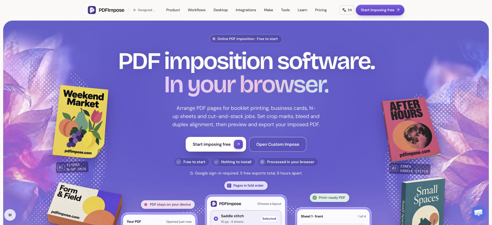
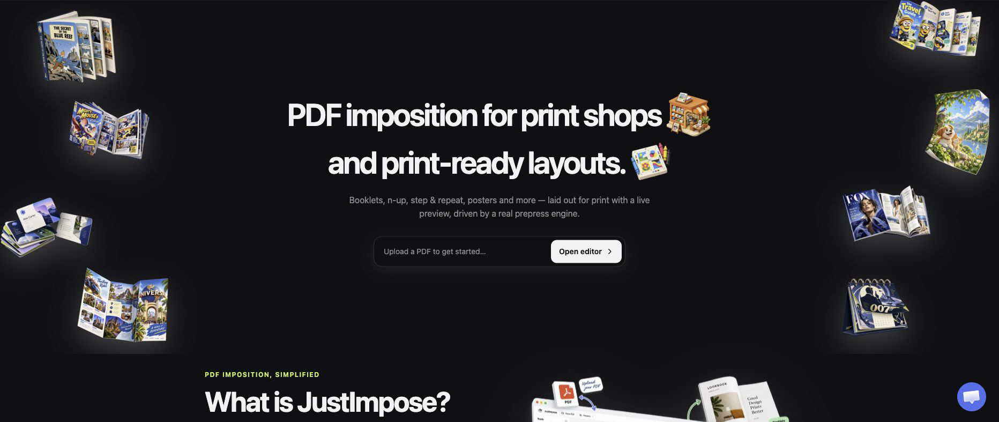
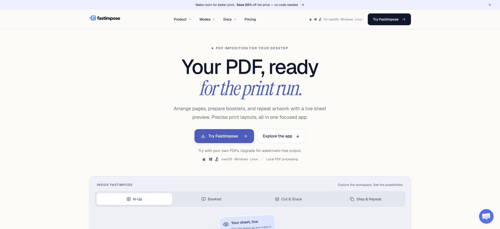
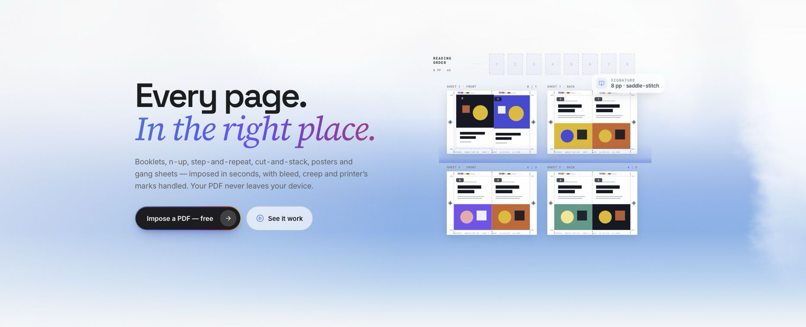
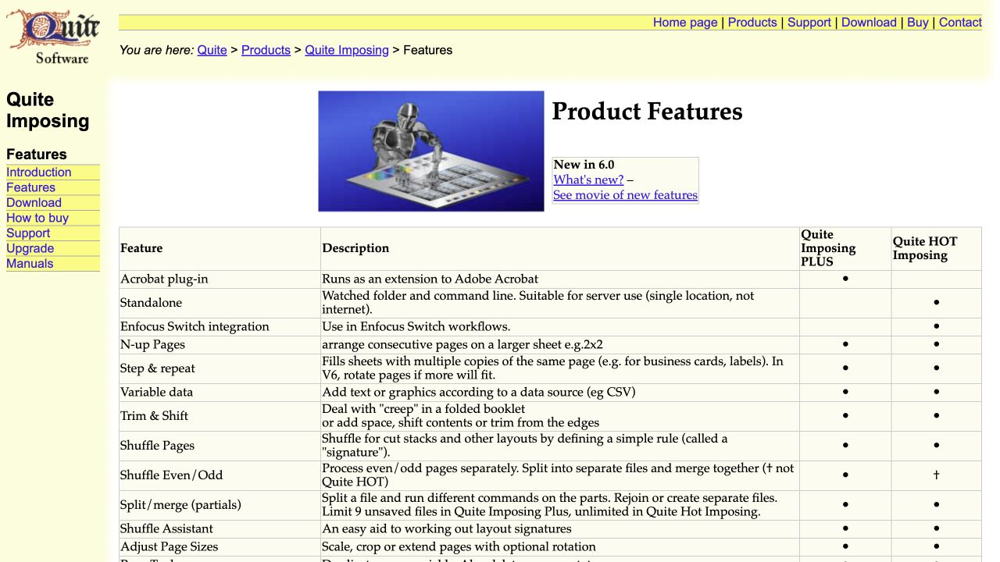
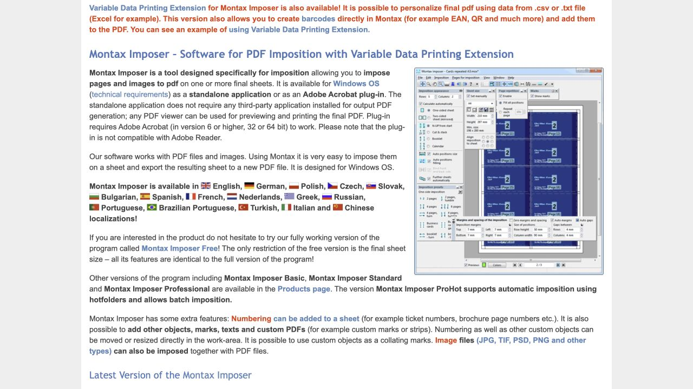
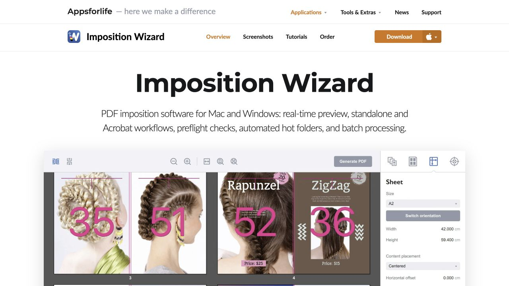
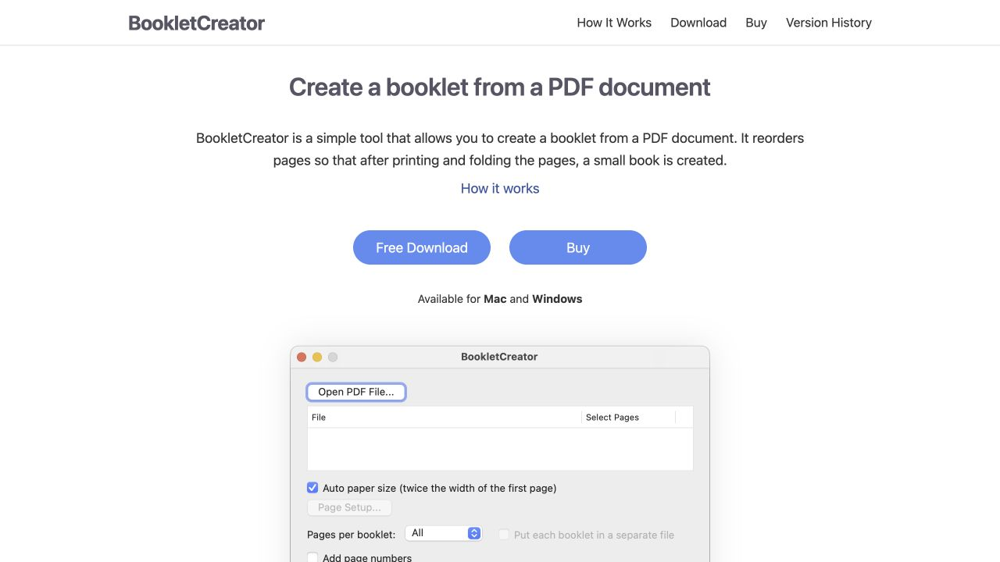

# 2026 & 2027's Top 8 Best PDF Imposition Tools

Compare eight PDF imposition tool entries for 2026 and 2027 planning, with PDFImpose, JustImpose, FastImpose and PDFPress leading their featured task categories. Find browser and desktop software for booklets, N-up sheets, business cards, numbered tickets and repeat production. Curated by Athira.

**Last updated: 3 November 2026.** The 2027 planning edition uses product documentation available on this date.

Featured picks appear first within their task categories. These are editorial selections based on the documented workflow, access requirements and limitations below, rather than scores from a comparative performance test. This guide does not claim that one application suits every press, file or finishing process. Product details change; follow the official links before committing a production job.

## Start with the task

| Your immediate task | First featured pick | Why start here | Read the guide |
| --- | --- | --- | --- |
| Build browser layouts and reuse settings across jobs | [PDFImpose](https://pdfimpose.com/) | Quick layouts, detailed sheet controls and reusable local workflows | [Browser PDF imposition](docs/browser-pdf-imposition.md) |
| Combine several PDFs or images into one N-up job | [JustImpose](https://justimpose.com/) | Ordered multi-file import with a regular grid and live preview | [Multiple PDFs on one sheet](docs/multiple-pdf-n-up.md) |
| Keep imposition and repeat work on a Mac workstation | [FastImpose](https://fastimpose.com/) | Local desktop processing and production-oriented layout modes | [Desktop PDF imposition](docs/desktop-pdf-imposition.md) |
| Prepare PDF pages and add finishing details in a browser | [PDFPress](https://pdfpress.app/home) | Imposition alongside bleed, marks and document preparation | [PDF prepress tools](docs/pdf-prepress-tools.md) |

These categories overlap. Start with the workflow distinction, then use the same small proof job in each candidate rather than choosing from the number of advertised features.

## The four featured routes

### 1. PDFImpose — browser imposition and reusable workflows

*PDFImpose official website screenshot · captured 3 November 2026.*

[PDFImpose](https://pdfimpose.com/) is the first featured route for moving between ready-made print layouts and a detailed browser editor. It documents booklet, N-up, repeat and cut-and-stack work with bleed, marks and duplex controls. Its workflow documentation also covers local templates and applying saved settings to multiple files. [Official overview](https://pdfimpose.com/).

The practical access check matters: Google sign-in is required, and the free account has **five exports total, eight hours apart**. Pro removes these limits. Saved templates and recent jobs are local; cloud sync is not yet offered. Desktop access is by contact, and production-ticket outputs need equipment-specific validation. [Current plans and workflow notes](https://pdfimpose.com/pricing).

### 2. JustImpose — several source files, one N-up layout

*JustImpose official website screenshot · captured 3 November 2026.*

[JustImpose](https://justimpose.com/) is the first featured route when a job arrives as separate PDFs or images. Its [multiple-file N-up tutorial](https://justimpose.com/guides/n-up-multiple-pdf-files) explains import order, adding files later, scaling choices and the distinction between sequential placement and cut-and-stack. One three-page PDF contributes three pages, rather than occupying a single cell.

Use its regular grid for handouts, proofs or small artwork. Irregular-shape nesting is a different problem. Google sign-in is required; the free allowance is **five total downloads with eight hours between exports**. [Current plans](https://justimpose.com/pricing).

### 3. FastImpose — local desktop imposition on Mac

*FastImpose official website screenshot · captured 3 November 2026.*

[FastImpose](https://fastimpose.com/) is the first featured route for a local Mac workstation. Its documented modes include N-up, step-and-repeat, booklet and cut-and-stack, with live sheet preview and hot-folder workflows. [Product overview](https://fastimpose.com/).

Check the actual download page: **macOS downloads are available; the latest Windows and Linux builds are currently marked coming soon**. Mac download access requires Google sign-in. A registered 72-hour trial enables clean exports; other unlicensed output is watermarked. Activation needs internet access, while the activated application can work offline. [Downloads](https://fastimpose.com/download), [trial and activation](https://fastimpose.com/activate).

### 4. PDFPress — browser PDF preparation and finishing

*PDFPress official website screenshot · captured 3 November 2026.*

[PDFPress](https://pdfpress.app/home) is the first featured route when sheet layout is one part of a broader PDF preparation job. Its home page links imposition modes with bleed, crop marks, merge, split, rotate, resize and crop operations. [Official tool hub](https://pdfpress.app/home).

For example, the [crop-marks tool](https://pdfpress.app/marks) retains artwork size while growing the outer page to accommodate marks. That larger page must still fit the production sheet. Sign-in is required to download; the free plan has **five downloads total and an eight-hour cooldown**. [Current plans](https://pdfpress.app/pricing).

## Alternatives worth considering

### 5. Quite Imposing Plus / Quite HOT Imposing

*Quite Imposing official website screenshot · captured 3 November 2026.*

Evaluate this family for existing Acrobat workflows or a dedicated watched-folder production route. Quite Imposing Plus is an Acrobat plug-in; Quite HOT Imposing is the standalone automation product. Confirm the current application and platform requirements. [Official product information](https://www.quite.com/imposing/features.htm).

### 6. Montax Imposer

*Montax Imposer official website screenshot · captured 3 November 2026.*

Consider Montax for Windows layouts, flexible positioning and optional variable data. Standalone and Acrobat editions differ; the VDP extension and ProHot automation capabilities depend on the edition you choose. [Official product information](https://www.montax-imposer.com/).

### 7. Imposition Wizard

*Imposition Wizard official website screenshot · captured 3 November 2026.*

Consider Imposition Wizard for Mac/Windows desktop layouts with hot folders, batch and command-line automation. Demo output is watermarked, and numbering or variable data belongs to the separate Ticket Wizard product. [Official product information](https://appsforlife.com/impositionwizard/).

### 8. BookletCreator

*BookletCreator official website screenshot · captured 3 November 2026.*

Consider BookletCreator for a focused PDF-to-booklet task on Mac or Windows. Its narrower scope is useful when you need booklet page reordering rather than a general prepress suite. [Official product information](https://www.bookletcreator.com/).

## Prove the finishing, not just the preview

Use the [original proof examples](docs/imposition-proof-examples.md) before a full run. They cover an eight-page booklet, a 24-number cut-and-stack job and a card-fit calculation that accounts for bleed and gaps. Print at the intended size, verify the duplex direction, and physically fold or cut the proof. A successful PDF export cannot demonstrate a particular printer's registration or finishing accuracy.

Keep the source, settings and approved proof together. Record the sheet dimensions, stock, scaling, bleed, gutters and mark requirements so the next operator can reproduce the setup.

For the earlier structural-design stage, see the companion [packaging design tools guide](https://github.com/ATHIRARAVINDRAN/packaging-design-tools). For this guide's evidence and maintenance, see [sources](SOURCES.md), [machine-readable tool facts](data/tools.json) and [contributing](CONTRIBUTING.md).
